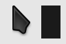

# Cursor

**Oxygen** cursors (the original KDE Oxygen designs, as collected by
[wo2ni/Oxygen-Cursors](https://github.com/wo2ni/Oxygen-Cursors)) recoloured to this
rice's icon colours: one per folder colour of the
[Cosmic-MonochromeDay](https://github.com/atraxsrc/cosmic-icon-themes) icon pack, **Silver**, **Graphite**, **Dark**.
All patched so they work in COSMIC's own apps.

| Variant | Preview | Body | Contrast on  `#E6E6E6` | Goes with |
| ------- | ------- | ---- | ------------------- | --------- |
| **Silver** (default) |  |  `#5C5C5C` | 5.4:1 | Silver folders |
| **Graphite** |  |  `#424242` | 8.1:1 | Graphite folders |
| **Dark** |  |  `#1A1A1A` | 13.9:1 | Dark folders |

Each variant is a normal folder here (`Oxygen-MonochromeDay-<Variant>/index.theme` + `cursors/`),
already fixed for COSMIC. Nothing is downloaded at install time.

The colours are made with [`recolour.py`](recolour.py) (the script from
cosmic-darkgold-theme, plus `--spread` and `--glow`): every body pixel keeps
its shading and takes the hue and saturation of the target colour, the white border,
black outline and shadow stay as they are, and the COSMIC symlinks are carried over.
Any coloured variant works as the base. To add a colour:

```bash
./cursors/recolour.py --base cursors/Oxygen-MonochromeDay-Graphite \
  --out cursors/Oxygen-MonochromeDay-Teal --name "Oxygen Monochrome Day Teal" --colour '#57B7B7' \
  --preview assets/cursors/Oxygen-MonochromeDay-Teal.png --bg '#E6E6E6'
```

then add `Teal` to `VARIANTS` in `install.sh` and `uninstall.sh`.

## Install

COSMIC has no cursor picker yet, so the script sets it.

```bash
./cursors/install.sh                      # Silver
./cursors/install.sh --variant Graphite     # another colour, see --list
reboot
```

Options:

| Option | Effect |
| ------ | ------ |
| `--variant NAME` | Which colour, default `Silver`; `--list` prints them |
| `--user` | Theme goes to `~/.local/share/icons` instead of `/usr/share/icons` (no sudo for the files; `/etc/environment` still needs it) |
| `--size N` | Cursor size, default 24 (`XCURSOR_SIZE_OVERRIDE=N` works too) |

What it does, with `<Theme>` the chosen `Oxygen-MonochromeDay-<Variant>`:

| Step | Where | Why |
| ---- | ----- | --- |
| Copy the theme | `/usr/share/icons/<Theme>` | An older, different copy is moved to `.<Theme>.bak-<timestamp>` |
| `XCURSOR_THEME` / `XCURSOR_SIZE` | `/etc/environment` | `cosmic-comp` reads these at login |
| `Inherits=<Theme>` | `~/.icons/default/index.theme` | X11 / XWayland apps |
| `cursor-theme` / `cursor-size` | gsettings | GTK apps |
| `flatpak override --user --env=…` | Flatpak | Sandboxed apps don't see `/etc/environment` |

Every config file it changes gets a `.bak-<timestamp>` copy first. Running it again
changes nothing. Switching variants is just running it again with another
`--variant`. The compositor only reads the cursor at startup, so a reboot (or
log out and back in) is required.

## Uninstall

```bash
./cursors/uninstall.sh
reboot
```

It removes every `Oxygen-MonochromeDay-*` variant from both `/usr/share/icons` and
`~/.local/share/icons`. Settings are only reset when one of them is the active
cursor; `/etc/environment` and `~/.icons/default/index.theme` get a
`.bak-<timestamp>` copy first.

## Why the symlinks

Without them the cursor is right in Firefox but **black in COSMIC's own apps**
(Terminal, Files, Settings, panel).

Oxygen only ships old X11 cursor names (`left_ptr`, `size_hor`, `openhand`, …),
which Firefox and XWayland apps ask for. COSMIC apps use the Wayland cursor-shape
protocol instead: they ask the compositor for CSS names like `default` or
`ew-resize`. When the theme has no file by that name, `cosmic-comp` falls back to
its built-in black cursor.

So the theme here has these extra relative symlinks in its `cursors/` folder:

```text
default, context-menu              -> left_ptr
crosshair                          -> cross
cell, zoom-in, zoom-out            -> plus
vertical-text                      -> xterm
grab / grabbing                    -> openhand / closedhand
no-drop                            -> dnd-no-drop
ew-resize / ns-resize              -> size_hor / size_ver
ne-resize, sw-resize, nesw-resize  -> size_bdiag
nw-resize, se-resize, nwse-resize  -> size_fdiag
```

The same trick fixes any older cursor theme with the black-cursor problem.

## Check it

```bash
echo $XCURSOR_THEME
ls -l /usr/share/icons/$XCURSOR_THEME/cursors/default   # -> left_ptr
cat /proc/$(pgrep -x cosmic-comp)/environ | tr '\0' '\n' | grep XCURSOR
```

If the arrow is still black after a reboot, the last command shows whether the
compositor got the variable. With `--user`, look in `~/.local/share/icons` instead.

## Credits

- Cursor artwork: the original **Oxygen** cursor designs from the
  [KDE Oxygen project](https://invent.kde.org/plasma/oxygen), in the colour
  variants collected by [**wo2ni/Oxygen-Cursors**](https://github.com/wo2ni/Oxygen-Cursors).
- This repo recolours them to the Monochrome Day palette with [`recolour.py`](recolour.py)
  and adds the COSMIC symlinks and the scripts.
- The upstream repo has **no LICENSE file**, so the licence of the artwork is
  not stated there. The MIT licence of this repo does not cover the cursor files;
  they keep whatever terms KDE's Oxygen artwork carries.
