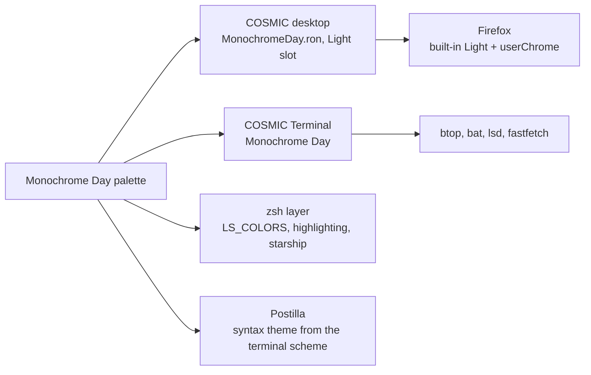

# Monochrome Day

> Grays only. No hue anywhere, weight and underline do the work.

Pop!_OS 24.04 on the COSMIC desktop, one palette carried through the whole
machine: desktop, terminal, shell, editor, browser. This note is the rice
describing itself, written in Markdown and rendered by **Postilla**.

## Palette

Every text colour is checked against the window background  `#E6E6E6`.

| Role | Hex | Contrast on background |
|------|-----|------------------------|
| Text |  `#616161` | 5.0:1 |
| Accent gray, accent |  `#5C5C5C` | 5.4:1 |
| Control |  `#5C5C5C` | 5.4:1 |
| Edge, borders |  `#1A1A1A` | 13.9:1 |
| High, success |  `#515151` | 6.4:1 |
| Higher, error |  `#424242` | 8.1:1 |
| Dim |  `#818181` | 3.1:1 |

Containers sit one step away from the background at  `#F1F1F1`, which is
what frosted glass blurs into.

## Where the colours go



## Setup, in order

- [x] Import `cosmic/MonochromeDay.ron` into Appearance, **Dark** slot
- [x] Import `cosmic-term/MonochromeDay-term.ron`, pick **Monochrome Day** for the profile
- [x] `./icons/install.sh` for the **Cosmic-MonochromeDay** icons, `./cosmic/install.sh` for fonts and the terminal look
- [x] `./zsh/install.sh`, `./lsd/install.sh`, `./fastfetch/install.sh`
- [x] Cursor: Oxygen-MonochromeDay-Silver
- [x] Wallpaper: `backgrounds/monochromeday-anime.png`
- [x] Screenshot for the README

## The baseline every rice shares

```ron
corner_radii: (
    radius_xs: (2.0, 2.0, 2.0, 2.0),   // squared corners
    radius_xl: (2.0, 2.0, 2.0, 2.0),
),
frosted: VeryLow,
frosted_windows: true,
frosted_panel: true,
frosted_applets: true,
frosted_maximized_apps: false,
gaps: (0, 7),
active_hint: 1,
```

Contrast is the WCAG ratio[^1], where $L$ is relative luminance:

```typst
$ (L_1 + 0.05) / (L_2 + 0.05) >= 4.5 $
```

---

*Rendered in Postilla, a Markdown notes app for COSMIC. The window is painted
with this rice's terminal scheme, imported as a syntax theme.*

[^1]: Web Content Accessibility Guidelines, success criterion 1.4.3. Normal text wants 4.5:1, large text 3:1.
